# Review: screens for the owner

Screenshots are taken by `npm run screens` (playwright.screens.config.ts): pages are signed in
with an API token placed in sessionStorage, so no password is ever typed or shown. Viewport
1180×820 (tablet landscape) unless the name says portrait (820×1180). All data is the E2E
centre's. Screenshots taken before 2026-10-22 show student names as `[student]`; name
redaction has since been removed.

## Every screen, per role

| Screen | Teacher | Owner | Admin |
|---|---|---|---|
| Sign in (signed out) |  | | |
| Lecture list |  ([portrait](../screenshots/lectures-teacher-portrait.png)) |  |  |
| Upload |  | (no upload: explains why) |  |
| Processing status |  |  |  |
| Analysis: overview |  |  |  |
| Analysis: findings |  |  |  |
| Analysis: structure, coverage, measures |    | | |
| Transcript |  ([portrait](../screenshots/transcript-teacher-portrait.png)) |  |  |
| Lecture notes | see below |  |  |
| Measures over time |  |  |  |
| Centre summary | (not available) |  |  |
| Users | (not available) | (not available) |  |
| Change password |  | same | same |
| Empty list, failed load, unknown lecture |    | | |

## Polish done in this pass
- Accessibility: `e2e/a11y.spec.ts` runs axe (WCAG 2.1 A and AA) on every screen for every role,
  plus the notes editor with its transcript panel, the add-user form and the change-user dialog,
  and a keyboard-only path (skip link; editing notes and ticking transcript lines with Enter and
  Space). Fixed: accessible names that didn't contain the visible text (account menu, "Move
  up", "Remove", "Change"); they now add hidden context after the visible words.
- An unexpected rendering failure shows a plain "This page couldn't be shown" page.
- Tablet portrait: wide tables (centre, measures over time, users) scroll sideways inside their
  own labelled, focusable region; the notes transcript panel becomes a side sheet.
- Print: lecture notes print as a handout (see `notes-print.png`).

## Lecture notes (milestone e)

| Screen | Role | Screenshot |
|---|---|---|
| Approved teacher version | teacher |  |
| Pipeline draft, never edited | teacher |  |
| Editing, transcript panel open | teacher |  |
| Editing, tablet portrait (panel as a sheet) | teacher |  |
| Read only | admin |  |
| Read only | owner |  |
| Print | teacher |  |

Decisions made on your behalf:
- The notes open in a reading view; the teacher presses "Edit notes" to get fields. Saving
  always returns the notes to draft (the API does this) and the editor says so before saving.
- Problems the API would reject (empty heading or bullet, no cited line, more than 6, a line
  no longer in the transcript) are checked before saving and shown beside the item, in the
  same place and words as the API's `422` answers.
- Approving is a separate step from saving and says it doesn't send the notes anywhere.
- Printing gives a handout: the draft label stays on, transcript excerpts and controls go.

## Centre summary and users (milestone f)

| Screen | Role | Screenshot |
|---|---|---|
| Centre summary, real E2E data | owner |  |
| Centre summary, wait time (low confidence) | admin |  |
| Centre summary, **synthetic** 5-teacher centre (mocked `/org/summary`, invented names) | owner |  |
| Same, tablet portrait | owner |  |
| Users | admin |  |
| Add a user | admin |  |
| Change a user | admin |  |

Decisions made on your behalf:
- Centre: three plain tables (lectures, findings, measures), teachers in the API's alphabetical
  order with the whole centre as the first row. Measures show one metric at a time (a pill
  picker, kept in the URL) so each teacher stays one row: lectures with a value, median, middle
  half (p25 to p75), low-confidence count, missing count with the most common reason. No
  range bars in the tables (charts over time were added later, see below), no colour that depends on a value. A group with no values reads
  "N/A" and why. Categories never checked read "Not checked in any lecture yet", never 0.
- An optional upload-date period (from/to) is offered; a reversed period shows the API's
  `bad_range` as a plain sentence.
- Users: a first password is **required** when adding someone, because code sign-in is off and
  an account without a password can't sign in. "Make one up for me" generates a 16-character
  password (no look-alike characters) and shows it so it can be read out. Deactivation is
  confirmed; deactivated people are listed separately and can be reactivated. Demoting
  yourself asks first; `409 last_admin` is explained in the dialog.
- Admins can't reset their own password from Users (the API would allow it); they use Change
  password, which needs the current one.
- E2E creates one `e2e-managed-…@staffroom1-e2e.com` user per run, deactivates it in the test,
  and deletes it in teardown with `DELETE /users/{id}` (the backend deletes only users with no
  data). The 9 deactivated leftovers from earlier runs were deleted on 2026-10-22.

## Measures over time (teacher progress view)

| Screen | Role | Screenshot |
|---|---|---|
| Your measures (charts, then the exact-values table) | teacher |  |
| Same, tablet portrait (charts one per row; table scrolls sideways in its own region) | teacher |  |
| **Synthetic** 9 lectures with N/A and low-confidence values (mocked `/lectures`, invented chapters) | teacher | 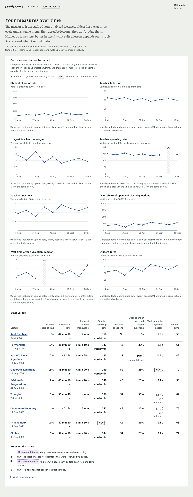 |
| Same, keyboard focus on a low-confidence point (reason shown) | teacher | 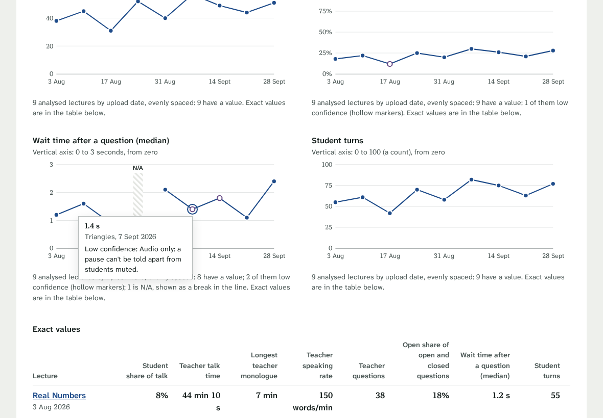 |
| Same, tablet portrait | teacher | 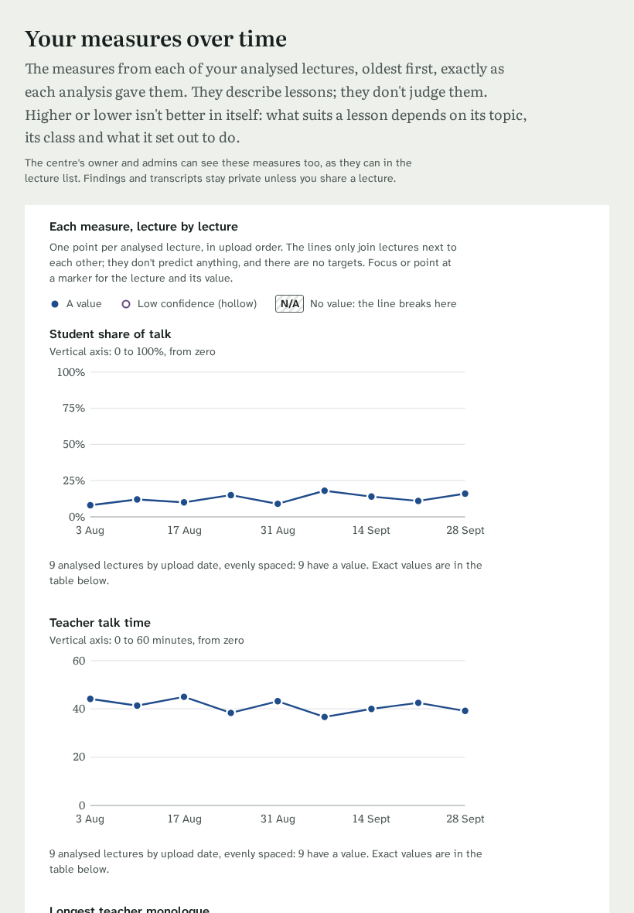 |
| One teacher's measures | owner |  |
| No teacher chosen yet | admin |  |

Decisions made on your behalf:
- `/progress`: one row per analysed lecture, oldest first, with the same eight measures as the
  centre summary, each exactly as the lecture's report gave it. No averages, no arrows or
  colours for up/down, and copy that says higher or lower isn't better in itself.
- **Line charts (added on your decision, 2026-10-22):** one small chart per measure above the
  table, one point per analysed lecture in upload order, evenly spaced (stated under each
  chart). One colour throughout; no target, reference or fitted line, no forecast, no
  colleagues. N/A (and "not computed") is a hatched band labelled N/A where the line breaks;
  the line never joins across it. Low-confidence values are hollow markers (shape, not only
  colour). The vertical axis always starts at zero and its range is written above the chart
  ("0 to 100%" for shares, so a small change can't look large; long durations in minutes).
  Every point and N/A band takes keyboard focus and shows the lecture, date, value and any
  reason (same on hover); each chart has a one-sentence description, and the table below,
  now headed "Exact values", stays the place for exact numbers.
- Reasons for N/A and low-confidence values are numbered notes under the table (identical
  reasons share a note) so the table stays readable; every N/A and low-confidence cell links to
  its note. The low-confidence mark is also written in the cell.
- Owners and admins pick a teacher (also linked from each teacher in the centre summary). They
  see the values they can already see in the lecture list.

## Upload: participant list and chat log (backend changelog item 2)

| Screen | Role | Screenshot |
|---|---|---|
| Teacher's row not recognised: asks them to pick it | teacher |  |
| Whole form with a list and the teacher chosen | teacher |  |
| Same, tablet portrait | teacher |  |
| Admin (teacher picker) | admin |  |

All names in these screenshots are invented.

Decisions made on your behalf:
- Both inputs sit in an optional "Participant list and chat (optional)" part of the form,
  below the lesson details, with the brief's explanation that names are used only for removing
  them from the transcript.
- The pasted text is read by `POST /participants/parse` and shown as an editable list (rename,
  remove, add, pick the teacher with a radio). When the teacher's row isn't recognised, the
  lecture can't be created until the teacher picks their row or confirms they aren't on the
  list. The API's warnings are shown as given.
- The list lives only in the page's memory: unlike the other details, it isn't saved with the
  upload draft in the browser, so a refresh loses it (names of minors stay out of browser
  storage). The chat file is uploaded as soon as it's chosen.
- The lecture page says "Uploaded with a participant list with N students and the meeting's
  chat" when they were given; names never come back.

## Backend changelog items 3–5: edit details, responses to findings, new results

| Screen | Role | Screenshot |
|---|---|---|
| Edit details, with what saving will do | teacher (and admin) | 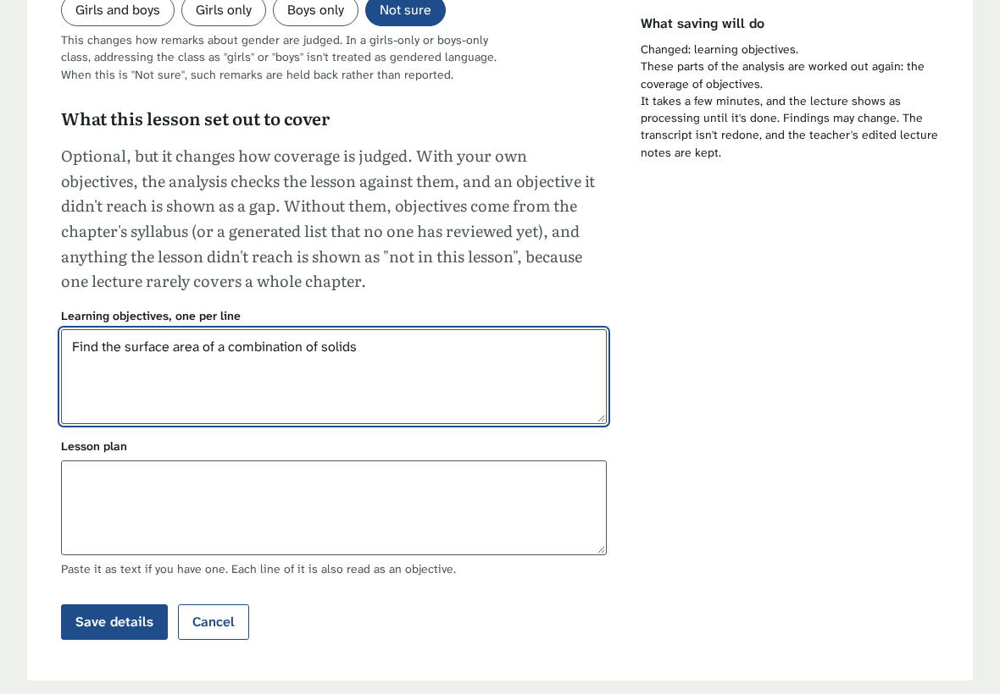 |
| Confirmation before reprocessing | teacher | 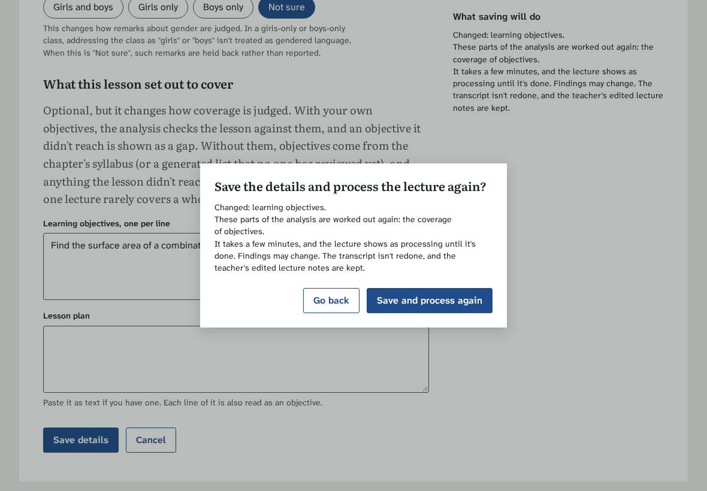 |
| Responses to findings | admin | 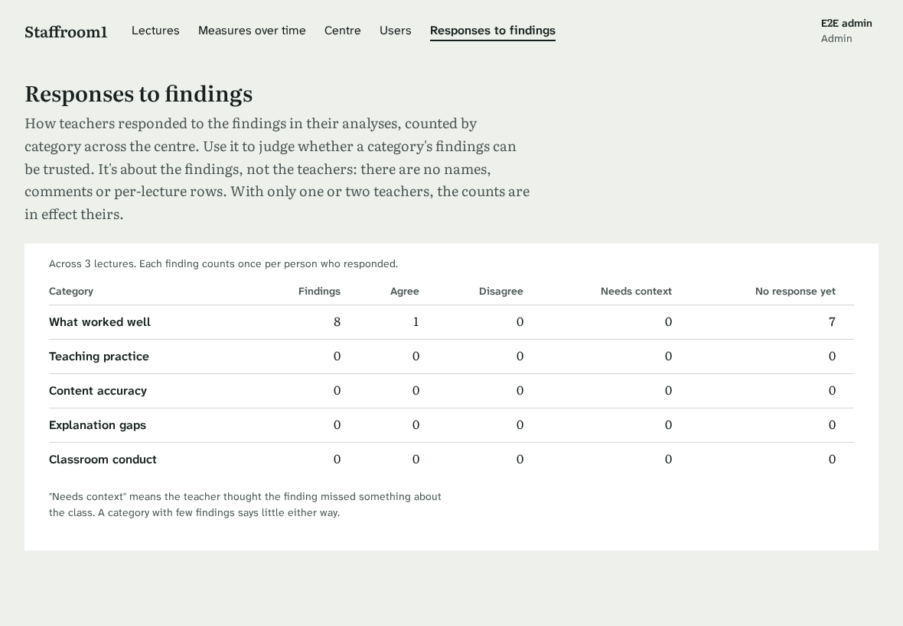 |
| "New results" mark in the list (list answer adjusted in the browser: no real lecture has one yet) | teacher | 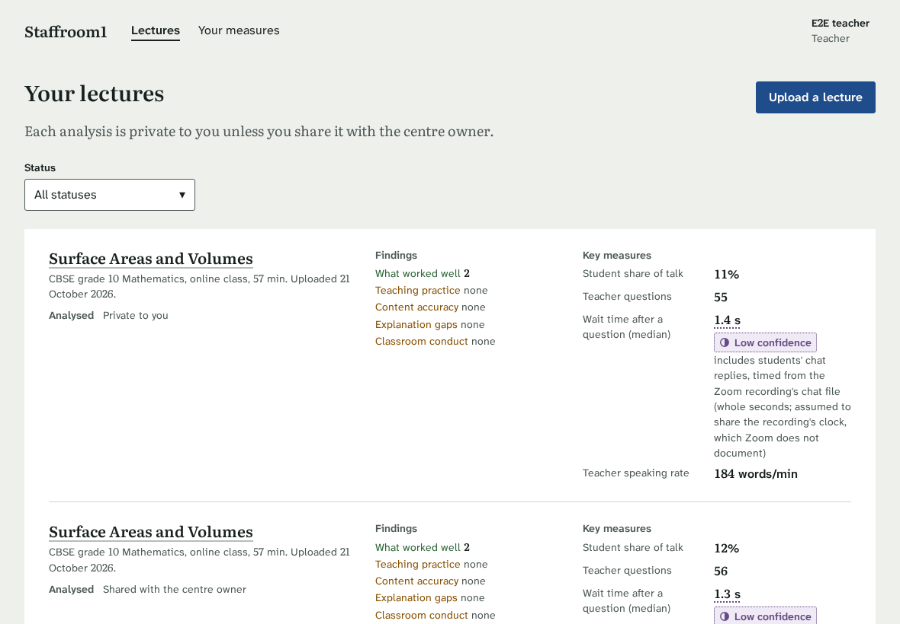 |

Decisions made on your behalf:
- **Edit details** is a link under the lecture title (lecture's teacher and admins; never owners;
  hidden while processing). A side panel says, as you change fields, which parts of the
  analysis are worked out again (from the API's field table), and a confirmation repeats it.
  After saving, the status page names the stages the API actually queued. Re-transcription is
  **not offered** (it renumbers segments, stales notes and costs ASR time); only the API has it.
  `409 already_queued` and `media_deleted` are explained in place.
- **Responses to findings** (`/admin/feedback`, admins only): one row per category with the
  counts as given (findings, agree, disagree, needs context, no response), a per-severity
  breakdown for review categories, and copy saying it's about the findings, not teachers. No
  agreement percentage is shown at all, so there's no share without its `n`. No date filter yet.
- **New results** is a quiet ink mark with a dot (not a colour that reads good or bad), with
  "Mark as seen" beside it. Opening the analysis clears it in the cached list too.

## Centre: measures over time and group by subject/grade (backend changelog item 7)

| Screen | Role | Screenshot |
|---|---|---|
| Centre, real E2E data (teacher grouping, week by week) | owner |  |
| Centre, real data grouped by subject, month by month | owner | 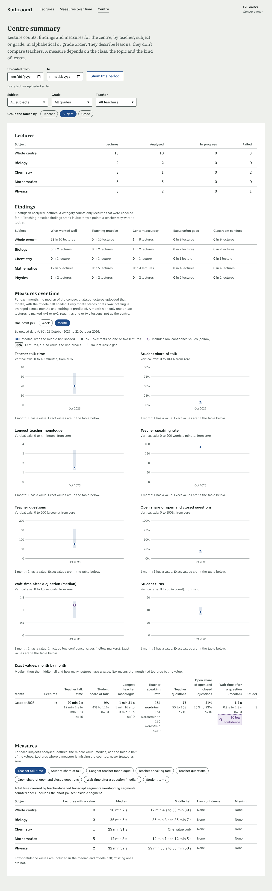 |
| Centre, real data grouped by grade | owner | 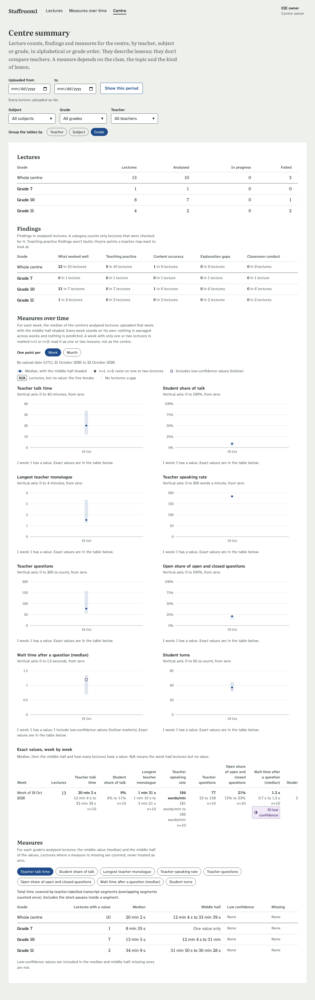 |
| **Synthetic** 12 weeks (mocked `/org/trend`): gaps, N/A, n=1/n=2, low confidence, tooltip | owner | 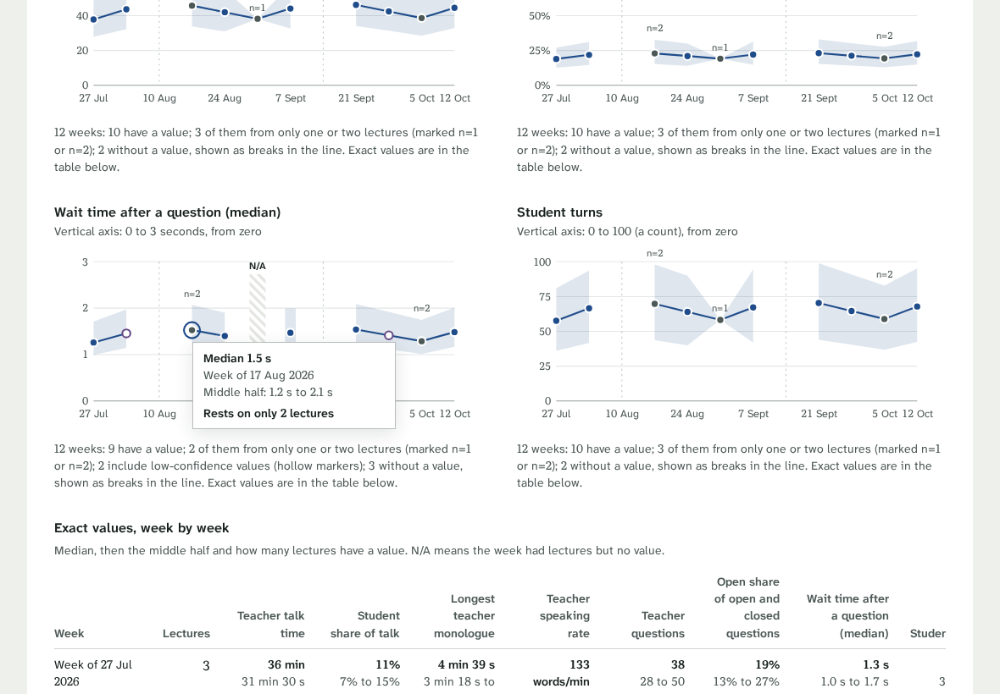 |
| Same, tablet portrait, grouped by subject | owner | 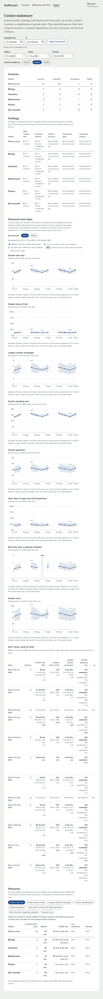 |

Decisions made on your behalf:
- **One chart per measure** (8 small multiples, two columns on wide screens, one on tablet
  portrait), the same conventions as the teacher's progress charts: axis from zero, one
  colour, no targets, no fitted line. The line joins **bucket medians**; the shaded band is the
  middle half (p25 to p75). Weeks start on Monday; dates are upload dates (UTC), because
  lectures have no separate "taught on" date.
- **Gaps are never zero:** a week with no lectures is an empty gap (dotted guide, "No
  lectures" when focused); a week with lectures but no value is the hatched N/A band with the
  reason. The line breaks at both.
- **Few lectures:** a point resting on one or two values carries "n=1"/"n=2" above it and a
  muted (grey) marker; its tooltip says "Rests on only 2 lectures". The figure caption counts
  them. **Low confidence:** the marker is hollow if any value in the week is low confidence,
  with "Low confidence: k of n" in the tooltip and the table.
- **Exact values** table under the charts: one row per week/month, every measure's median,
  middle half and n (n bold when it is 1 or 2). The per-group Measures table stays below that.
- **Group the tables by teacher / subject / grade** (pills, kept in the URL as `group=`):
  switches the Lectures, Findings and Measures tables. Order is the API's: teachers and
  subjects alphabetical, grades numeric, "Not recorded" last. Subjects are merged whatever the
  spelling ("Maths" = "Mathematics"), and the page says so.
- **Subject, grade and teacher filters** (dropdowns, in the URL) narrow both the tables and the
  charts; the choices list every subject/grade/teacher in the chosen period. The week/month
  toggle applies to the charts only.

## Owner's decisions (2026-10-22)
1. **Categories a lecture was never checked for** now read **"Not checked for this lesson"**
   (lecture list, overview and findings). The centre summary keeps "Not checked in any lecture
   yet" for a group with no checked lecture; "Not yet reported (still being validated)" is left
   only for a category the centre hasn't released at all (none today).
2. **First password stays required** when adding a user while email codes are off. No change now.
3. **The participant list isn't kept across a refresh.** Accepted as is.
4. **Measures over time has line charts** per measure (see above).
5. **E2E test users are deleted after each run** via the new `DELETE /users/{id}` (users with
   no data only; others must be deactivated). The 9 leftovers were deleted.

## Still open
- **Backend request #5** (participant parser and names with digits): the backend found it isn't
  a bug (a host row like "E2E teacher" has no name part); the form lets the teacher pick their
  row.
